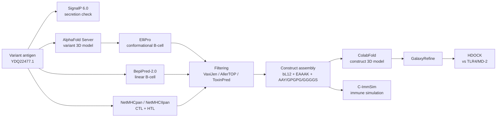
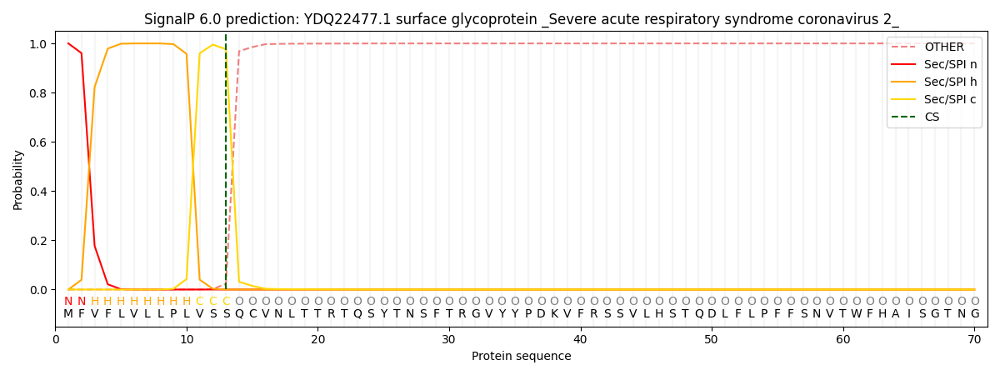
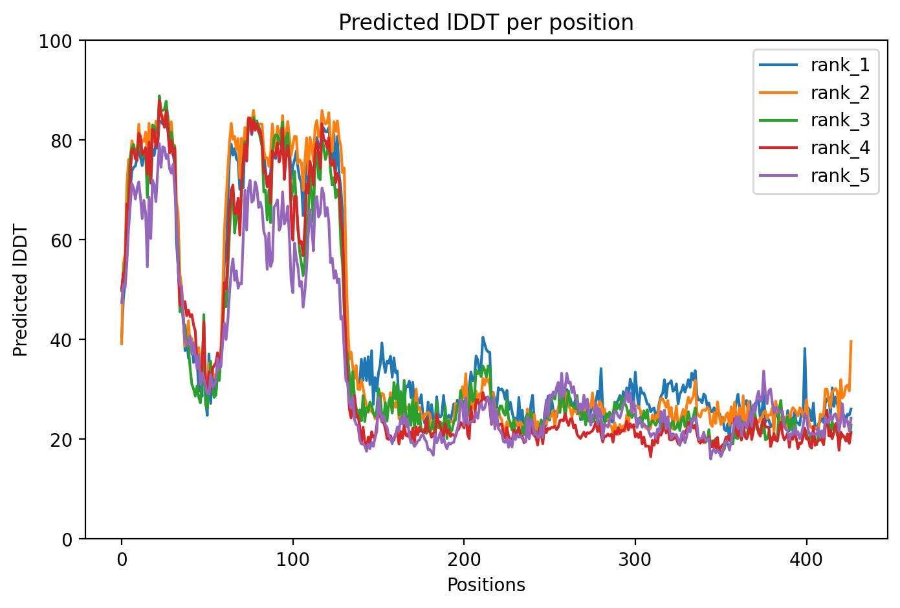
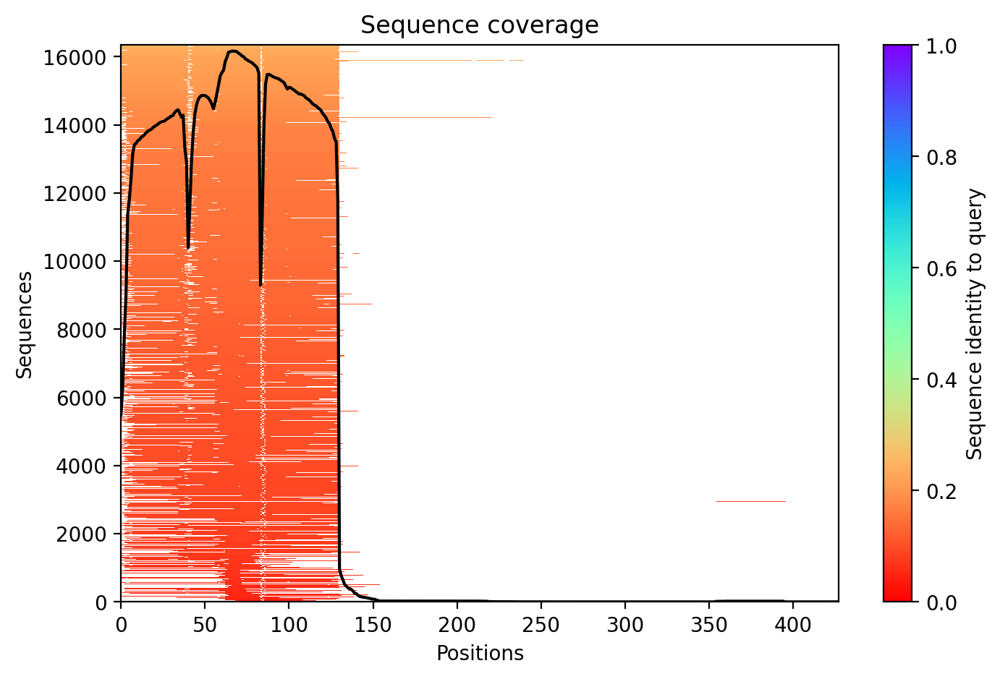
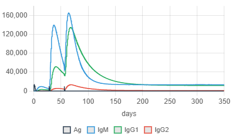
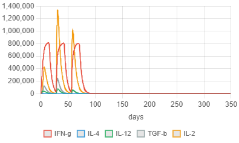
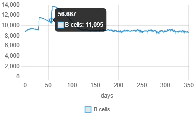
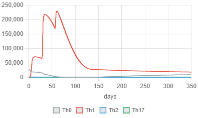
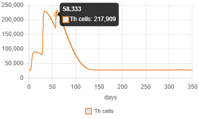

# Multi-Epitope Vaccine Design Against a SARS-CoV-2 Variant Spike

In-silico design of a multi-epitope vaccine candidate against the SARS-CoV-2 Spike glycoprotein **variant YDQ22477.1** — from antigen selection to immune simulation — using only free, web-based immunoinformatics tools.

**Author:** Adeeba Fatima
**Course:** Computational Vaccine Design (Applied Immunoinformatics & Reverse Vaccinology) — BioTech Catalyst

---

## Overview

Most computational vaccine studies target the Wuhan-Hu-1 reference Spike (UniProt P0DTC2). This project instead targets a **circulating variant isolate**, YDQ22477.1 (1,268 aa), which differs from the reference by **18 amino-acid substitutions** (including 17 RBD mutations such as L452R, E484A, F486V, Q498R, N501Y, Y505H) and two deletions (Δ24–26, Δ69–70) — 98.2% identity overall.

Because no experimental structure or AlphaFold DB entry exists for a variant isolate, the variant antigen structure was **predicted de novo** and validated against experimental Spike structures. All epitope predictions were run on the variant sequence; experimentally validated epitopes from IEDB (Wuhan numbering) were used only as a cross-check benchmark.

## Pipeline



## Results

### 1. Antigen is a secreted surface protein

SignalP 6.0 predicts a Sec/SPI signal peptide (residues 1–13, cleavage between 13–14), confirming the variant Spike enters the secretory pathway and is surface-displayed — a valid vaccine target.



### 2. Variant antigen structure — predicted and validated

The variant model (`structures/sequence_structure.pdb`) superimposed onto the experimental Spike trimer (PDB 6VXX) with **RMSD 0.852 Å over 937 atoms**, and **all 16 ACE2-interface RBM residues** (identified from PDB 6M0J, chain E within 4 Å of chain A) are retained in the aligned region — the receptor-binding site is correctly folded in the variant model.

### 3. B-cell epitopes (ElliPro on the variant model)

| Cluster | Residues (variant) | Length | Score | Note |
|---|---|---|---|---|
| 3 | 234–260 | 27 aa | 0.772 | Highest-score cluster |
| 4 | 385–532 | 148 aa | 0.740 | RBD-spanning |
| 6 | 323–363 | 41 aa | 0.689 | RBD N-terminal flank |
| 14 | 366–373 | 8 aa | 0.568 | FAPFFAFK — compact RBD epitope |

Three B-cell epitopes were carried into the construct (FAPFFAFK; the 41-aa RBD-flank cluster; the 27-aa 234–260 cluster).

### 4. T-cell epitopes

**CTL (MHC-I, NetMHCpan, HLA-A\*02:01, percentile ≤ 1.0):**

| # | Epitope | Residues | Percentile | Region |
|---|---|---|---|---|
| 1 | YLQPRTFLL | 264–272 | 0.02 | NTD |
| 2 | TLDSKTQSL | 104–112 | 0.03 | NTD |
| 3 | FQFCNDPFL | 128–136 | 0.41 | NTD |
| 4 | KIYSKHTPI | 197–205 | 0.97 | NTD |
| 5 | NIADYNYKL | 412–420 | 0.24 | RBD |
| 6 | KLPDDFTGC | 419–427 | 0.48 | RBD |
| 7 | VLNDILSRL | 971–979 | 0.03 | S2 |

**HTL (MHC-II, NetMHCIIpan, HLA-DRB1\*01:01, percentile ≤ 10.0):**

| # | Epitope | Residues | Percentile | Rationale |
|---|---|---|---|---|
| 1 | VVLSFELLHAPATVC | 506–520 | 1.4 | Strongest binder; RBD |
| 2 | SNFRVQPTESIVRFP | 311–325 | 2.4 | NTD–RBD boundary |
| 3 | NIDGYFKIYSKHTPI | 191–205 | 4.3 | NTD coverage |
| 4 | LKPFERDISTEIYQA | 456–470 | 6.0 | RBD; overlaps B-cell region |
| 5 | FAPFFAFKCYGVSPT | 366–380 | 8.0 | Contains B-cell epitope FAPFFAFK |
| 6 | LSSKFGAISSVLNDI | 961–975 | 2.9 | S2 coverage |

Full prediction tables: [`results/peptide_table_MHC-I.csv`](results/peptide_table_MHC-I.csv) and [`results/peptide_table_MHC-II.csv`](results/peptide_table_MHC-II.csv).

### 5. Vaccine construct

**427 aa, ~44.9 kDa** (`data/multi_epitope_vaccine_construct.fasta`):

| Block | Content | Length |
|---|---|---|
| Adjuvant | bL12 (P9WHE2, *M. tuberculosis*) — TLR4 agonist | 130 aa |
| Linker | EAAAK (rigid helix) | 5 aa |
| CTL block | 7 × 9-mer epitopes joined by AAY | 87 aa |
| HTL block | 6 × 15-mer epitopes joined by GPGPG | 115 aa |
| B-cell block | 3 epitopes joined by GGGGS | 86 aa |

All 16 epitopes verified present exactly once, in designed order.

### 6. Construct structure (ColabFold + GalaxyRefine)

The adjuvant domain (residues ~1–130) is confidently folded (pLDDT ~75–90); the epitope/linker block scores low (~20–40), as expected for short epitopes joined by flexible linkers — intrinsic disorder by design, not model failure. Rank-001 model: **pLDDT 39.9, pTM 0.249**; refined with GalaxyRefine (`structures/model_1.pdb`).






### 7. Immune receptor docking (setup)

Docking of the refined construct (**ligand**) against the human TLR4/MD-2 ectodomain (**receptor**, `structures/3FXI_TLR4_clean.pdb`) via HDOCK. Rationale: the receptor is the larger, stable partner (~90 kDa vs ~44.9 kDa), and the bL12 adjuvant is a TLR4 agonist — the construct must engage TLR4 for adjuvanted innate activation.

### 8. Immune simulation (C-ImmSim)

Three injections (time steps 1, 84, 168 — prime–boost–boost), adjuvant 100, 1,000 antigen units, seed 12345, 1,050 steps, HLA A\*02:01 / B\*07:02 / DRB1\*01:01.

**Antibodies:** IgM peaks first (~day 40), followed by class-switched IgG1/IgG2 that re-expand after each boost and settle at memory-level titers — the classic primary → secondary → memory pattern.



**Cytokines:** IFN-γ and IL-2 dominate with a peak after each injection — a Th1-skewed response.



**Cell populations:** B cells expand to ~11,095 (day ~70) and plateau at memory levels; CD4+ T helpers peak at 217,909; Th1 dominates over Th2/Th17; CD8+ T cells remain near baseline.








## Repository Structure

```
├── README.md
├── LICENSE
├── data/                  # Input sequences and epitope selections
├── results/               # Raw MHC-I / MHC-II prediction tables
├── structures/            # Variant antigen model, refined construct, TLR4 receptor
├── figures/               # All figures shown above
└── docs/                  # Full workflow + methodology & results reports (Word)
```

## Tools Used

| Tool | Purpose | URL |
|---|---|---|
| SignalP 6.0 | Signal-peptide prediction | https://services.healthtech.dtu.dk/services/SignalP-6.0/ |
| AlphaFold Server | Variant antigen 3D model | https://alphafoldserver.com |
| ElliPro (IEDB) | Conformational B-cell epitopes | https://tools.iedb.org/ellipro/ |
| BepiPred-2.0 (IEDB) | Linear B-cell epitopes | https://tools.iedb.org/bcell/ |
| NetMHCpan / NetMHCIIpan (IEDB) | MHC-I / MHC-II binding | https://tools.iedb.org/mhci/ |
| VaxiJen 2.0 | Antigenicity | http://www.ddg-pharmfac.net/vaxijen/VaxiJen/VaxiJen.html |
| AllerTOP v2 | Allergenicity | http://www.ddg-pharmfac.net/AllerTOP/ |
| ToxinPred | Toxicity | http://crdd.osdd.net/raghava/toxinpred/ |
| ProtParam | Physicochemical characterization | https://web.expasy.org/protparam/ |
| ColabFold (AlphaFold2) | Construct 3D model | https://colab.research.google.com/github/sokrypton/ColabFold |
| GalaxyRefine | Model refinement | https://galaxy.seoklab.org |
| HDOCK | Protein–protein docking | http://hdock.phys.hust.edu.cn/ |
| C-ImmSim | Immune simulation | https://kriferrosh.web.unc.edu/cimmsim/ |
| PyMOL / Mol* | Structure visualization | https://pymol.org / https://molstar.org |

## Limitations

- The construct's global pLDDT is low (39.9) because the epitope block is intrinsically disordered by design; only the adjuvant domain is confidently folded.
- IEDB experimental epitopes are Wuhan-numbered; cross-checking required coordinate mapping (−5 shift after residue 70 due to the Δ24–26/Δ69–70 deletions), and epitopes disrupted by variant mutations lose direct experimental support.
- `results/peptide_table_MHC-I.csv` is truncated at the spreadsheet row limit (1,048,576 rows) and is not the complete raw IEDB output; selections were made from top-ranked predictions.
- All evidence is in silico — docking scores and C-ImmSim dynamics are plausibility arguments, not proof of immunogenicity. Experimental validation is required before any development claim.

## License

Released under the [MIT License](LICENSE).# sarscov2-variant-multiepitope-vaccine
